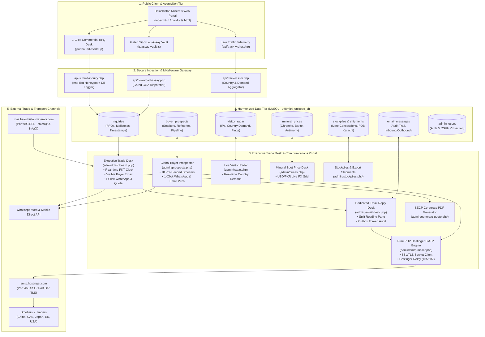
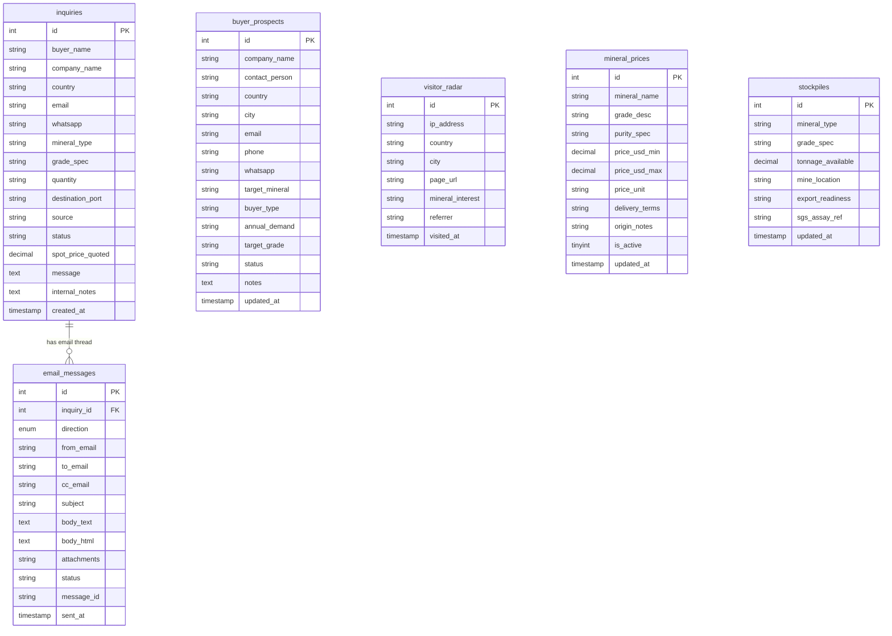

# Balochistan Minerals (Pvt) Ltd — System Architecture & Knowledge Graph

This document provides a comprehensive operational blueprint and architectural knowledge graph of the **Balochistan Minerals (Pvt) Ltd** commercial export desk platform.

---

## 1. System Knowledge Graph

---

## 2. Relational Database Schema (ERD)

All tables use `ENGINE=InnoDB DEFAULT CHARSET=utf8mb4 COLLATE=utf8mb4_unicode_ci`:

---

## 3. Operational Systems & File Map

* **Executive Dashboard (`admin/dashboard.php`)**: Full commercial overview, live Pakistan Standard Time (`Asia/Karachi`), visible buyer emails with 1-click clipboard copy, and landing mailbox clarity.
* **Email Desk (`admin/email-desk.php`)**: Dedicated split-pane B2B corporate communications terminal.
* **SMTP Mailer Engine (`admin/smtp-mailer.php`)**: Socket client connecting to `smtp.hostinger.com` on port 465 (SSL) / 587 (TLS).
* **Global Prospector (`admin/prospects.php`)**: 18 pre-seeded international smelter & refinery profiles with 1-click WhatsApp and email outreach.
* **Live Visitor Radar (`admin/radar.php`)**: International IP demand telemetry and real-time visitor logs.
* **Gated Lab Assay Vault (`js/assay-vault.js` & `api/download-assay.php`)**: Captures high-intent buyers seeking certified COA reports (`documents/Balochistan_Minerals_Assay_Summary.html`).
